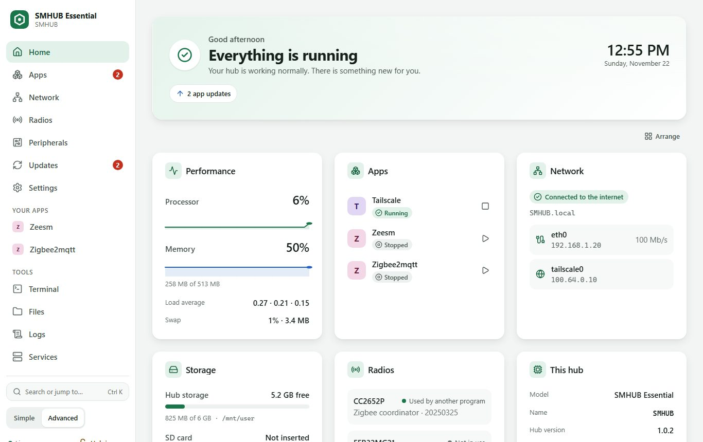
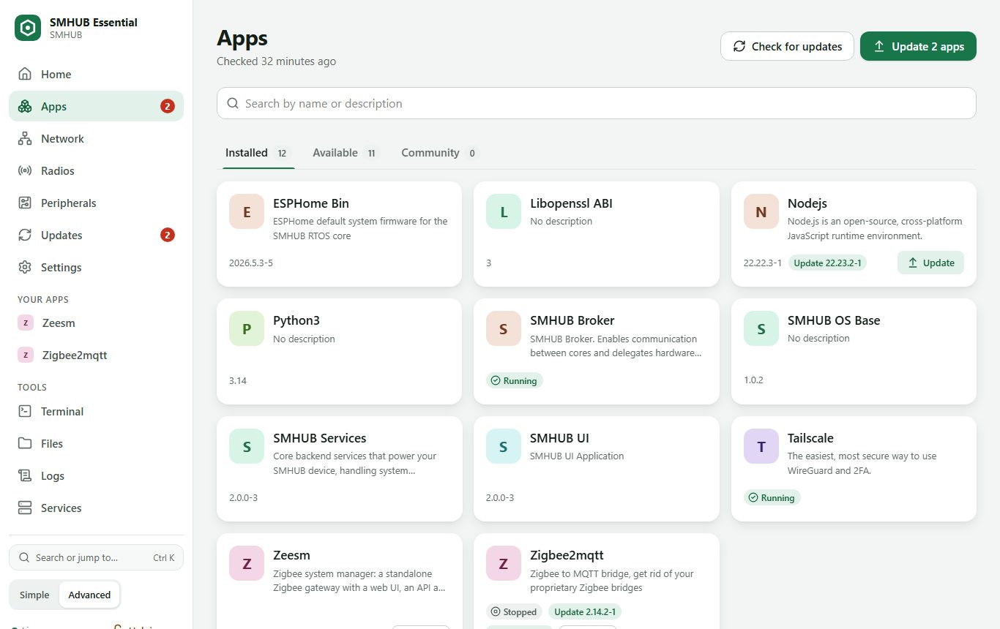
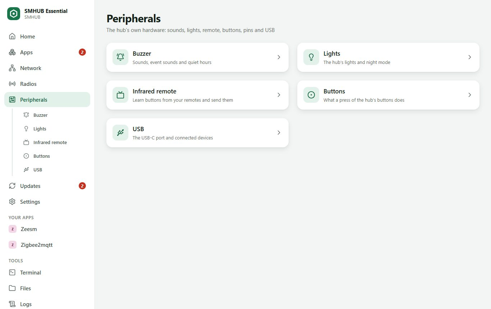
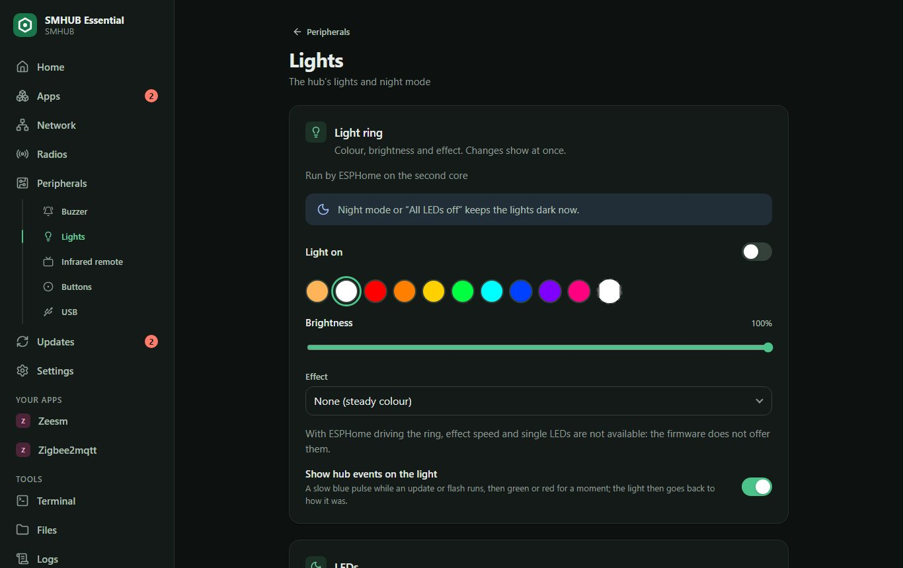
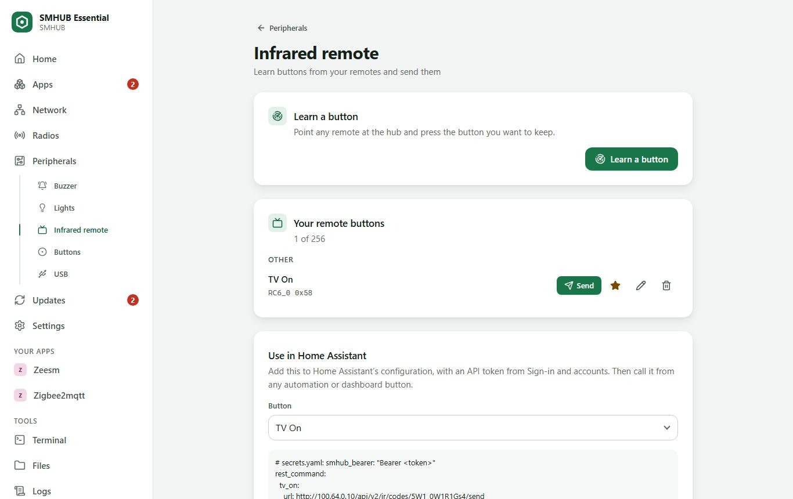
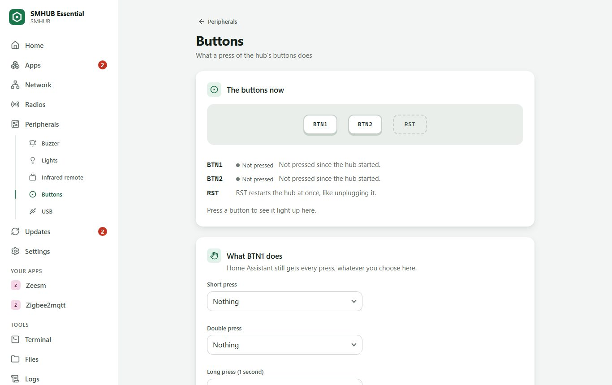
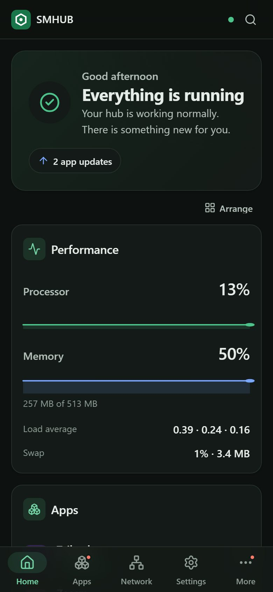

# smhub-services

The core software of the SMLIGHT SMHUB: one small Rust daemon (`smhubd`), a web
UI (Preact) and the API between them (API v2). Together they run the hub's
system, network, apps, radios and its own hardware. They ship as two opkg
packages for the hub: `smhub-services` (the daemon) and `smhub-ui` (the web UI).

This is version 2.0 of `smhub-services` and `smhub-ui`. It replaces the Python
backend and the React web UI of 1.x, keeps every user's data and settings, and
can go back to 1.x.

**Status:** on the development channel. Everything a user can do in 1.x is
here, plus the hub's own hardware (buzzer, light ring, LEDs, buttons, infrared).
Stable users stay on 1.x until upgrade tests on more hubs and models are done
([docs/plan.md](docs/plan.md)).

## Install on a hub

This installs the newest version from GitHub on an SMHUB, test versions
included. It replaces the 1.x packages and keeps the database, the apps and
their settings; going back to 1.x is possible.

1. Open a terminal on the hub: the terminal in the hub's web UI, or SSH.
2. Copy this command, paste it into the terminal and press Enter:

   ```sh
   curl -fsSL https://raw.githubusercontent.com/smlight-smhub/smhub-services/main/packaging/update-beta.sh | sh
   ```

   In the web UI's terminal, Ctrl+V does not paste. Use **Ctrl+Shift+V**,
   **Shift+Insert**, or right-click and choose **Paste**. On a Mac, Cmd+V
   works.

3. If the terminal is not signed in as root (the web UI's terminal is not),
   enter that user's password when `sudo` asks for it.
4. When it prints `Done`, reload the hub's page in the browser.

The script ([packaging/update-beta.sh](packaging/update-beta.sh)) downloads the
two packages from the newest
[release](https://github.com/smlight-smhub/smhub-services/releases), pre-releases
included, installs them with `opkg` and writes a log to
`/tmp/smhub-update.log`. The web UI's terminal may disconnect while the
service restarts; the installation carries on.

**By hand:** download `smhub-services_<version>_riscv64.ipk` and
`smhub-ui_<version>_all.ipk` from a release, copy them to the hub and install
them as root:

```sh
opkg install ./smhub-services_<version>_riscv64.ipk ./smhub-ui_<version>_all.ipk
```

**Going back to 1.x:** install the 1.x packages the same way, with
`--force-downgrade` (`tests/hub/downgrade_upgrade.sh` does the round trip and
checks it).

**AI coding agents:** read [AGENTS.md](AGENTS.md) before changing anything.

<p>
  
  
</p>
<p>
  
  
</p>
<p>
  
  
</p>
<p>
  
</p>

## What it does

| Area | In the web UI |
|---|---|
| Home | status at a glance, performance, apps, network, storage, radios, live data |
| Apps | install, update, start, stop and configure apps (Zigbee2MQTT, Matterbridge, …) from the package feeds |
| Network | Ethernet, Wi-Fi, mobile modem (LTE), VPN |
| Radios | the Zigbee, Thread and Z-Wave radios: firmware, flashing, which app holds each |
| Peripherals | buzzer, light ring and LEDs, night mode, infrared remote, buttons, USB |
| Updates | OS updates and their release channel |
| Settings | hub name, accounts and API tokens, appearance, language and regional formats, backups, MQTT broker, serial bridge (ser2net), SSH, the built-in ESPHome device, system (restart, factory reset) |
| Tools | terminal, files, logs, services |

The UI has two levels (Simple and Advanced), 31 languages with local formats
for numbers, units and dates, light and dark themes, and works on phones.

## Measured

1.x and 2.0 on the same hub (SMHUB Essential, OS 1.0.2, one 1 GHz RISC-V core,
488 MiB RAM), the same day, with the same scripts (`tests/hub/compare_run.sh`,
`boot_timing.sh`, `compare.sh`). Each is restarted and left alone until five
minutes after its kernel starts; a real Chromium opens the page over the local
network. Full report with charts:
[docs/report/index.html](docs/report/index.html) (open the file in a browser).

| | 1.x: smhub-services 1.1.0, smhub-ui 1.0.6 | 2.0: smhub-services 2.0.0, smhub-ui 2.0.0 |
|---|---:|---:|
| Restart: kernel start to a page with data | 93.2 s | **43.8 s** |
| Backend's own memory (RssAnon) | 76.6 MiB | **1.4 MiB** |
| Backend resident memory (RSS) | 95.4 MiB | **5.1 MiB** |
| Backend threads | 8 | **2** |
| Backend CPU with nobody using the hub | 1.44 % | **0.003 %** |
| Page ready on a visit (desktop, median of 5) | 3,345 ms | **168 ms** |
| Page ready, first visit after a restart | 4,359 ms | **2,913 ms** |
| Page ready with a phone-speed CPU (median of 3) | 3,931 ms | **447 ms** |
| Downloaded to open the page | 2,727 KB | **232 KB** |
| Requests until the page is ready | 34 | **6** |
| Browser script time | 331 ms | **23 ms** |
| Page memory (JS heap) | 11.4 MB | **4.4 MB** |
| Hub CPU for one visit (5 opens, then open for a minute): backend / whole hub | 13.94 s / 18.07 s | **2.31 s / 6.26 s** |
| Installed: backend / web UI | 153.4 / 2.7 MiB | **26.7 / 0.9 MiB** |
| Update download (both packages) | 35.4 MiB | **7.4 MiB** |

## Develop on your computer

For changing the code, not for installing it on a hub (for that, see
[Install on a hub](#install-on-a-hub)). The daemon and the web UI run on your
computer with a fresh database; features that need the hub's hardware report
themselves as unavailable. You need Docker; on Windows, run the scripts in Git
Bash.

Build the builder image once (Rust 1.95 with the RISC-V target, Zig, Node.js):

```bash
docker build -t smhub-services-build:2 -f packaging/Dockerfile.build packaging
```

Tests and lints:

```bash
packaging/cargo.sh cargo test --workspace
```

```bash
packaging/cargo.sh cargo clippy --workspace --all-targets
```

Run the daemon on your machine, on port 8000, with its OS files under a
throwaway directory:

```bash
docker run --rm -p 127.0.0.1:8000:8000 -v "$PWD:/src" -w /src smhub-services-build:2 sh -c 'mkdir -p /tmp/r && cargo run -p smhubd -- --root /tmp/r --listen 0.0.0.0:8000 --socket none --db /tmp/r/backend.db --upload-dir /tmp/r/up'
```

Run the web UI against it (Node.js 20.19 or newer); open http://localhost:5173:

```bash
cd ui && npm ci && npm run dev
```

The UI's development server forwards `/api` and `/ws` to `SMHUB_URL`, which is
`http://127.0.0.1:8000` unless you set it. To use a hub of your own instead,
set `SMHUB_URL=http://<hub address>`. Saving anything in the UI then changes
that hub.

## Build the packages

```bash
SEED_DB=<path to a seed database> packaging/build-ipk.sh
```

It writes `out/smhub-services_<version>_riscv64.ipk` and
`out/smhub-ui_<version>_all.ipk`. A first install copies the seed database to
`/opt/smhub-services/config/backend.db`; release builds use the one the 1.x
package ships. SMLIGHT's release packages are built from a commit of this
repository by SMLIGHT's package builder.

To publish them for the install script, attach both files to a GitHub release
for the version's tag, as a pre-release for a test version. How versions are
named, and why the package version of `2.0.0-beta.1` is `2.0.0~beta.1-1`, is in
[docs/architecture.md](docs/architecture.md#version-numbers).

```bash
gh release create v2.0.3 out/smhub-services_2.0.3-1_riscv64.ipk out/smhub-ui_2.0.3-1_all.ipk
```

## Repository layout

| Path | What |
|---|---|
| `api/openapi.yaml` | API v2: the contract between daemon and UI |
| `crates/` | the daemon: `smhubd` (binary), `smhub-api`, `smhub-auth`, `smhub-store`, `smhub-sys`, `smhub-model` |
| `ui/` | the web UI (Preact, TypeScript, Vite), its scripts and browser tests |
| `helpers/radio-flash/` | the Python helper that flashes radio firmware |
| `packaging/` | the builder image, the package build, package scripts, a device-tree overlay, vendored flasher libraries |
| `tests/hub/` | checks that run on a live hub |
| `docs/` | vision, decisions, architecture, hardware, verification, plan; `docs/reference/` describes the 1.x backend |

## Documents

| Read | To learn |
|---|---|
| [AGENTS.md](AGENTS.md) | how to work in this repository: commands, rules, the definition of done |
| [docs/vision.md](docs/vision.md) | what we are building, the priorities in practice, targets, what must not break |
| [docs/decisions.md](docs/decisions.md) | every stack and architecture decision, its reason and how it is checked |
| [docs/architecture.md](docs/architecture.md) | how the daemon, the API and the web UI fit together, compatibility, limits |
| [docs/peripherals.md](docs/peripherals.md) | the hub's own hardware: buzzer, light ring, LEDs, buttons, infrared, UPS board |
| [docs/verification.md](docs/verification.md) | how 2.0 is checked, the results, what it does not do yet, and the translations |
| [docs/plan.md](docs/plan.md) | where 2.0 stands, what it must show before the stable channel, risks and open questions |
| [docs/reference/old-backend-behaviour.md](docs/reference/old-backend-behaviour.md) | what the 1.x backend stores and does: the compatibility reference |

## Contributing

Contributions are welcome. Before your first pull request is accepted, you sign
the [contributor agreement](CLA.md) once; a bot on the pull request asks you to.
[CONTRIBUTING.md](CONTRIBUTING.md) explains how, and how to report a security
issue privately.

## License

The software is licensed under the
[PolyForm Noncommercial License 1.0.0](LICENSE.md), with one additional
permission: on hardware made or sold by SMLIGHT, such as SMHUB devices, you may
use, change and distribute it for any purpose, commercial purposes included.
Any other commercial use needs a commercial license from SMLIGHT.

The radio flash helper (`helpers/radio-flash/`) and the vendored flasher
libraries (`packaging/vendor/`) are licensed under the
[GPL-3.0](LICENSES/GPL-3.0.txt).

Trademarks and product names mentioned in this repository belong to their
respective owners.
