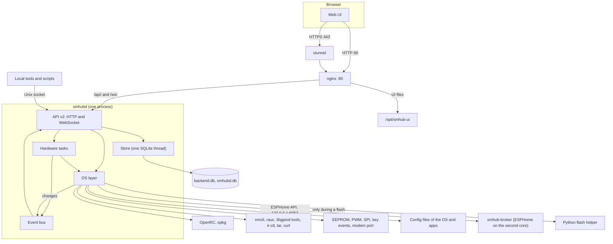

# Architecture

How the daemon (`smhubd`), API v2 and the web UI fit together, and how they
live with the hubs and the OS image already in use. The reasons are in
[decisions.md](decisions.md), referenced as D1–D58.

## Overview

nginx and stunnel stay as they are (D18). The daemon listens on
`127.0.0.1:8000` and on `/run/smhub-backend.sock` only. Both serve the same
routes; a caller the local socket accepts counts as signed in (D42).

## Repository layout

| Path | Contents | Builds |
|---|---|---|
| `api/openapi.yaml` | the API v2 description (D7) | the UI's types |
| `crates/` | the Rust workspace | package `smhub-services` |
| `ui/` | the web UI, its build scripts and browser tests | package `smhub-ui` |
| `helpers/radio-flash/` | the Python flash helper (D6) | part of `smhub-services` |
| `packaging/` | the builder image, the package build, the control files and scripts of both packages, the UPS board's device-tree overlay, the flash helper's Python libraries | the `.ipk` files |
| `tests/hub/` | checks and measurements that run on a live hub | — |
| `docs/` | these documents, the measurement report and screenshots | — |

## Compatibility with existing hubs

The one hard requirement (D3). The API and the UI are new; what is stored on
the hub is not. The daemon treats everything in this table as a fixed format.
What 1.x stores and writes, in detail, is in
[reference/old-backend-behaviour.md](reference/old-backend-behaviour.md).

| What | Where it lives | Rule |
|---|---|---|
| Accounts | table `user`; Argon2 and legacy bcrypt hashes | verified as they are; a legacy hash is upgraded at the next sign-in, as 1.x does |
| Sign-in on or off | settings page `security`, key `enabled` | honoured (D41). While it is on, the factory account's earlier password hash waits in `smhubd.db` (`hub_settings`, key `factory_admin_hash`) and is written back when it is turned off |
| Per-user preferences | table `usersettings` | 1.x's columns keep their meaning; new preferences go into the second file (D21) |
| Apps and their settings | tables `apps`, `appsettings` | same keys (package names) and value formats |
| Settings pages | tables `pages`, `devicesettings` | same page keys and setting keys; values stored as 1.x stores them |
| Setting-to-file registry | tables `configsource`, `configsetting` | same meaning; filled from each `schema.json` the same way |
| Other tables | `fileitem`, `alembic_version` | left as they are, so 1.x still accepts the database |
| App config files | the files each `schema.json` names | the same setting gives the same file |
| OS config files | hostname, time zone, USB mode, SSH, mosquitto and its password file, serial bridge, the opkg channel file | same files, same formats; the serial bridge's file is written in the form the hub's ser2net reads, and 1.x's form is still read (D58) |
| Network connections | NetworkManager's own store | the same connection names are updated, never duplicated |
| Autostart and watchdog | OpenRC runlevels; flag files in `/opt/share/services/` | same |
| App web addresses | stunnel entries; port = the app's port + 20000 | same ports |
| ESPHome and RTOS settings | device-tree overlays, the key in the RTOS firmware, the Bluetooth mode file | same |
| Backups | `tar.xz` with `metadata.json`; the factory backup folder | same format in both directions |
| Package behaviour | post-install seeds the database if missing; the OTA hook reinstalls core packages | same |

A database at an older revision of 1.x's schema is brought to its last one
(`4cc919e10054`) by the daemon at start, in one transaction, with the same
changes Alembic makes, written as plain SQL in `smhub-store`. A database at a
revision the daemon does not know is left as it is.

### What the OS image expects

The OS image is not changed. Its scripts and configuration use the backend in
these ways, and the daemon keeps each one.

| The image | Expects | The daemon |
|---|---|---|
| nginx | port 8000 on loopback, with addresses under `/api/` and `/ws/`; WebSockets only under `/ws/` | listens there; API v2 uses `/api/v2/` and `/ws/v2/` |
| nginx | request bodies up to 1 MiB (its default) | uploads go in pieces of 768 KiB, which also lets an upload resume (D9) |
| nginx | serves `/opt/smhub-ui` uncompressed; unknown paths get the start page | the first load is kept under 400 KB uncompressed (D31); the UI uses plain page addresses (D34) |
| Readiness check before apps start | `/api/v1/login/user-session` on port 8000 answers 200 or 401 | answers 401, and is ready before the check first asks (D48) |
| UI files without cache headers | browsers can keep the 1.x UI for days after the update | answers the 1.x UI's sign-in call (`POST /api/v1/login/cookie`) with success so it reloads into 2.0's UI; 2.0's UI reloads itself when `System.ui_version` differs (D51) |
| First-boot and modem scripts | an OpenRC service named `smhub-services` | same name (D4) |
| A first-boot script | edits tables `apps` and `appsettings` in the database file with `sqlite3` | same file and tables (D21) |
| stunnel | includes `/opt/smhub-services/config/stunnel.conf.d` | writes app entries there, in the same format |
| logrotate | `/var/log/smhub-services.log` | logs there |
| OTA hook | packages named `smhub-services` and `smhub-ui` | same names (D4) |

The `smhub-services` init script belongs to the package, not to the image.

None of the following is needed. Each would make the hub a little better if
the image is changed for other reasons:

- nginx: `Cache-Control: no-cache` for `index.html` and a long cache lifetime
  for the hashed files under `/assets/` (D51 works around the missing
  headers), and precompressed files, which would bring the first load to about
  a third of its size.
- Boot: a faster boot from changes to the `net-online` ping, the Python LED
  animation and the three init scripts that use `pre_start`.

### Update and going back

- **Update:** `opkg` replaces the two packages, as for any update. The
  outgoing package's `prerm` stops the service and marks it as running. The
  new `postinst` installs the OpenRC script, points `/opt/bin/smhub-services`
  at `smhubd`, copies the seed database only when there is none, and starts
  the service again if it was running. The daemon then brings an older
  database to the last 1.x revision. With sign-in on, users sign in once more.
- **Going back:** installing the 1.x packages (`opkg install
  --force-downgrade`) gives 1.x back, and it finds the database as it left
  it. 1.x ignores the daemon's own file, `smhubd.db`.
  `tests/hub/downgrade_upgrade.sh` does the round trip and checks it.

## API v2

The conventions are in D8–D10; every route, field and error is in
`api/openapi.yaml`.

### Addresses

| Kind | Address | Notes |
|---|---|---|
| Resources and actions | `/api/v2/…` | JSON |
| Event connection | `/ws/v2/events` | one per browser tab |
| Terminal | `/ws/v2/terminal` | bytes |
| Log following | `/ws/v2/logs/{name}` | lines |
| File and backup transfer | `/api/v2/files/…`, `/api/v2/backups/…`, `/api/v2/uploads/…` | downloads streamed; uploads in pieces under 1 MiB |
| For the OS image and a cached 1.x UI | `/api/v1/login/user-session`, `/api/v1/login/cookie` | the only API v1 addresses (D48, D51) |

WebSocket addresses sit under `/ws/` because the hub's nginx upgrades
connections only there.

### Resources

| Resource | Holds |
|---|---|
| `health`, `system` | a check that the daemon answers; model, hardware and features, versions, time zone, sign-in mode, first-run state (D10) |
| `session`, `security`, `users`, `tokens`, `preferences` | sign-in, the sign-in switch, accounts, API tokens for other programs (D55), per-user language, formats, UI level and home page layout |
| `apps`, `apps/{name}` | the store list, installed apps, their state, settings, changelog and icon; the Tailscale and Thread status of those apps |
| `services` | OpenRC state of system services and apps; start, stop, restart |
| `network`, `wifi`, `vpn`, `lte` | interfaces and Ethernet, Wi-Fi connections and scans, the WireGuard tunnel, the modem |
| `radios` | the radios of this model, their firmware and flashing |
| `updates` | OS releases, the release channel, installing an OS update |
| `metrics` | CPU, memory, storage, load, uptime |
| `operations` | work that takes time, and its progress |
| `hardware`, `ir`, `ups` | the buzzer, the light ring, the LEDs and the buttons; infrared; the UPS board ([peripherals.md](peripherals.md)) |
| `settings/…` | hub name and time zone, the time zone list, the MQTT broker and its users, USB, SSH and its keys, the serial bridge, ESPHome, backups, hardware |
| `backups`, `uploads`, `files`, `logs` | backups and the factory backup, upload pieces, the file manager, log history |

The UPS board page is in development builds of the UI only (`npm run dev`, or a
build with `VITE_UPS=1`), not in the release packages; the daemon serves
`/api/v2/ups` either way.

### Events

One connection per browser tab. Resources that can be subscribed: `system`,
`metrics`, `network`, `wifi`, `vpn`, `lte`, `services`, `apps`, `updates`,
`radios`, `operations`, `hardware`, `ir`.

| Direction | Message | Meaning |
|---|---|---|
| UI to hub | `sub` with a list of resources | "I am showing these" |
| UI to hub | `unsub` with a list of resources | "I stopped showing these" |
| hub to UI | `state` | a resource's whole state: at once when subscribed (D9), then after each change |
| hub to UI | `operation` | an operation's step, progress and result, sent to every connection |
| hub to UI | `reload` | the connection fell behind; ask for the state again |
| UI to hub, hub to UI | `ping`, `pong` | the UI pings every 25 s; without a pong within 10 s it reconnects, waiting 1 s, then longer, up to 15 s |

### Operations

A command that takes time (install, upgrade or remove an app, update the
package lists or every app, flash a radio, install an OS update, restore a
backup) answers at once with an operation. Its progress and result arrive as
events and can also be read with a GET, so a page opened later, or a second
browser, sees the same progress. Operations of one kind and target run one at
a time, app operations one at a time, and an OS update or a restore excludes
every other operation. Creating a backup is not an operation: the archive is
streamed to the browser as it is made.

## Daemon

### Process model

One process, started and supervised by OpenRC's `supervise-daemon`, which
restarts it after a crash (2 s later, at most 10 times in 5 minutes).

| Thread | Work |
|---|---|
| Runtime thread | All network I/O, routing, WebSockets, timers, child-process events (D16) |
| Store thread | Both SQLite connections; takes jobs from a bounded queue (D20) |
| Blocking pool, up to 4, created on demand | File reads and writes, password checks, log reads; a thread ends after 10 s idle |

The daemon sends OpenRC its readiness message (`notify="socket:ready"`) once
both listeners are open (D48). The app sync, the stunnel entries, the ESPHome
settings, the watchers and the hardware tasks start after that, in the
background. On SIGTERM it stops accepting connections and lets running
requests finish; OpenRC sends SIGKILL if it has not stopped after 30 s.

### Daemon workspace

Dependencies point downward only: a crate uses only crates below it in this
table.

| Crate | Contains | May depend on |
|---|---|---|
| `smhubd` (binary) | start-up, flags, wiring, signals, readiness | everything below |
| `smhub-api` | routes, sign-in layer, WebSocket endpoints, API v2 shapes, the hardware tasks, the app sync, the watchers | `smhub-store`, `smhub-sys`, `smhub-auth`, `smhub-model` |
| `smhub-store` | SQLite access: 1.x's schema and its upgrade steps, and `smhubd.db` | `smhub-model` |
| `smhub-sys` | everything that touches the OS (the counterpart of 1.x's `system-config`) | `smhub-auth`, `smhub-model` |
| `smhub-auth` | password hashes, session and API tokens, the Mosquitto password format, random identifiers | `smhub-model` |
| `smhub-model` | plain data types, error codes, the hardware model table, melodies, time formats; no I/O | — |

### Request path

1. nginx forwards the request to the daemon.
2. Limits apply first: body size and request time.
3. The sign-in layer runs. A request that changes something is refused when
   its `Origin` names another host. A request then passes if it carries a
   valid API token, or a valid session, or it arrived on the local socket from
   an accepted user, or the hub does not require sign-in, or its path is on
   the public list (D40, D42, D55).
4. The route handler validates input and calls the store or the OS layer. A
   request that changes something runs in its own task, so it finishes even if
   the browser goes away (D52).
5. The answer follows the contract (D7) and carries `Cache-Control: no-store`.

A panic inside a handler ends that request only (D44).

### State and storage

- **The existing database** (`backend.db`) holds users and their preferences,
  the app list and app settings, the settings pages, and the registry that
  maps a setting to a config file. It is small and written rarely. Its
  structure does not change (D21).
- **A second small file** (`smhubd.db`, next to it) holds what is new:
  session and API token hashes, new per-user preferences such as the UI level
  and the home page layout, the hardware settings, infrared codes, and
  bookkeeping.
- **Most real state is in neither.** App settings live in each app's own files,
  network settings in NetworkManager, packages in opkg, services in OpenRC. The
  daemon reads those sources when asked and does not keep a copy.
- **Start-up does no synchronisation loop.** 1.x re-syncs every app's settings
  into the database on every start. The daemon syncs an app when it is
  installed, upgraded or removed, and at start only when the installed
  packages, their `schema.json` files or the feed lists differ from the last
  run.

### Event bus

- One bus inside the process, with a fixed capacity.
- A resource is published when something changes: OpenRC's and opkg's state
  folders (inotify), NetworkManager (`nmcli monitor`, only while a page shows
  the network), an operation's progress, the hardware tasks. Live metrics are
  sent every 3 s, only while a page shows them.
- Nothing is formatted or sent when no client is listening. A resource's
  state is worked out once for every client that shows it.
- A client that falls behind is told to reload its state. It never makes a
  queue grow.

### OS layer

`smhub-sys` is the only crate that touches the operating system (D23).

| Function | How |
|---|---|
| Services: status, start, stop, autostart | OpenRC's state files for status; `rc-service` and `rc-update` for actions (D26) |
| Packages: list, install, remove, upgrade | opkg's own lists and status file for reading; `opkg` for actions (D50) |
| App descriptions | each package's `schema.json` under `/var/lib/opkg/info/` |
| App and OS config files | readers and writers for JSON, YAML, flat `key value` and one-value files, driven by the registry in the database |
| Network | `nmcli` in terse mode; changes followed with `nmcli monitor` while a network page is open; WireGuard as a NetworkManager keyfile (D24) |
| OS update | `rauc install`, its progress lines parsed (D24); the release list from the update server through `curl`, cached for an hour and checked daily |
| Hostname, time zone, USB mode | their files under `/etc`, and the `hostname` command for a new name; the time zone list from the OS's index of current zone names (`zone.tab`), each zone once, and a zone given by an old name saved under its current one; the UTC offset for night mode and quiet hours from `date +%z`, read at most every ten minutes and again at once after the time zone is changed |
| MQTT broker | `mosquitto.conf` through the line-preserving editor; users in its password file, in Mosquitto's `$7$` format (D53) |
| SSH | three `sshd_config` directives through the line-preserving editor; the device user's `authorized_keys` |
| Serial bridge | `/etc/ser2net/ser2net.yaml` in the form ser2net reads (D58) |
| GPIO | libgpiod tools, lines by name, held only while used (D25); `i2cdetect` for the UPS board's bus scan |
| The hub's own hardware | the buzzer's PWM output, the light ring's SPI bus, the LEDs through the libgpiod tools, the buttons through the kernel's key events, infrared through `ir-ctl` and `ir-keytable`; what the second core owns through ESPHome's native API (D54) |
| ESPHome on the second core | device-tree overlays, the API key patched into its firmware, the Bluetooth proxy mode file |
| Device identity | the EEPROM driver's file |
| LTE modem | its AT port, opened exclusively |
| App web UIs | stunnel proxy entries, rewritten only when they change |
| Backups | `tar` with `xz`, streamed in both directions |
| Files, logs, metrics | the file manager's folders; files under `/var/log`, followed with inotify; `/proc` and `statvfs` |
| Web terminal | a login shell for the device user (`setsid -c su -l smlight`) on a pseudo-terminal |
| Internet requests | the system `curl` (D19) |
| Radio firmware | the Python flash helper (D6) |

Every path is resolved under a root directory given at start (`--root`). On
the hub it is `/`. On a development PC it is a throwaway directory, and
`--bin-dir` puts stand-ins for commands such as `nmcli`, `rc-service` and
`opkg` first on the path.

**One owner per device.** A serial port or a GPIO line is held by one program.
When the daemon needs a port that an app holds (to flash a radio), it stops that
app's service first and starts it again afterwards, as 1.x does. The serial
bridge shows which app holds a port. Whether the bridge really shares a port is
read from the kernel's TCP tables, not from OpenRC: ser2net runs on, counted as
started, when it refuses its file (D58).

### Hardware models

One table in `smhub-model` describes each model string from the EEPROM: product
name and family, the radios (port, chip, firmware key, vendor, protocols), and
which peripherals and slots the board has (light ring, buzzer, infrared,
microSD, the 4G slot, add-on detection). The radio page, the app defaults (for
example the Zigbee adapter type) and the `system` resource all come from it
(D27).

### Limits

Each is a constant in the code, next to what it limits; the general ones are
in `crates/smhub-api/src/state.rs` (`limits`).

| Limit | Value |
|---|---|
| Open client connections | bounded by nginx in front (`worker_connections 1024`); WebSockets per kind below |
| Request body, ordinary routes | 256 KiB; upload pieces and a file saved in the file manager 772 KiB |
| Uploads | 8 at once, pieces of 768 KiB, 2 GiB each; unfinished ones removed when an hour old (checked every 30 minutes) and at start |
| Request time | 150 s (the longest calls that answer directly, Wi-Fi connect and service actions, take up to 90 s; longer work is an operation) |
| Commands | a time limit each, set per command: mostly 5 s, 90 s for a service action, an hour to extract a backup; output kept up to 4 MiB |
| Event connections | 16; a message from the browser at most 64 KiB |
| Event bus capacity | 256 messages |
| Live metrics | every 3 s, only while a page shows them |
| Log followers | 4 |
| Web terminal sessions | 2 |
| Folder listing | 5,000 entries |
| Password checks at once | 1 |
| Failed sign-ins | 10 a minute for the whole hub, then refused until the minute has passed; an unknown name waits 400 ms |
| Store queue | 64 jobs |
| SQLite page cache | 256 KiB for `backend.db`, 64 KiB for `smhubd.db` |
| Service states | read from OpenRC's files, cached 2 s; the cache is dropped when OpenRC's state folders change |
| Cached update check | 1 hour; checked 10 minutes after start, then daily; changelogs of the newest 4 releases per channel |
| Text downloaded with `curl` | 4 MiB |
| Operations kept | the last 20 |
| Sessions | 30 days |
| API tokens | 32; last use written at most once a minute |
| ESPHome API connection | 1; 32 commands and 64 events waiting; 256 entities; reconnects after 1–60 s; the hub pings after 30 s of quiet; silence of 90 s ends it |
| Buzzer | 16 sounds waiting; the same sound not within 1 s; 60 s of sound a minute; an event sound waits at most 10 s; a melody at most 512 characters, 256 notes, 30 s |
| Light ring | one renderer, 25 frames a second only while something moves |
| Infrared | 256 saved codes, an import included; 32 sends waiting, 5 a second; learning 30 s, one at a time; a raw code at most 1,024 timings and 2 s; one `ir-keytable` line kept up to 256 bytes |
| Buttons | one reader of the key events; 16 events read at a time and 16 waiting; a double press within 400 ms; a long press from 1 s, BTN2's at most 3 s |
| Hardware activity kept | the last 100 lines, in memory |
| Serial bridge | 4 ports; after a save, ser2net's ports are waited for at most 2 s |
| User melodies | 32 |

## Web UI

### Layers

Each layer uses only the ones below it.

| Layer | Contains |
|---|---|
| Pages | one folder per section, each page loaded when first opened (D31) |
| Shell | navigation, header, sign-in, first-run setup, command palette, notices, the operations tray |
| Kit | buttons, fields, cards, dialogs and lists, built on native controls (D29); the app-settings form renderer (D33) |
| State | the resource store (D30), user preferences, the current UI level (D35) |
| Text and formats | translations (D36); formatting of numbers, dates, units and currencies (D37) |
| API client | generated types (D7), one request function, the event connection (D9) |
| Tokens | colours, spacing, type, motion (D32) |

### How a page gets its data

1. The page's widgets name the resources they show.
2. The store subscribes once per resource over the event connection.
3. The daemon sends each resource's state at once, then again after each
   change.
4. Widgets redraw from the store. A second widget showing the same resource
   costs nothing.
5. When the page closes, the subscription is dropped 10 s later, so quick
   navigation does not resubscribe. A tab hidden for 30 s drops its live
   resources except `system` and `operations`, and subscribes again when it is
   shown.

The first screen needs the UI files, the `system` resource, the session, and
the event connection.

### How a setting is saved

One function for every setting (D30): show the new value, send the change, then
either take the daemon's answer as the truth or restore the old value and show
the daemon's message next to the field it names. If the change needs a restart,
one notice says so everywhere.

### Two levels

The UI level is a per-user preference (D35). A page declares which of its parts
are advanced; the shell hides advanced pages and parts at the simple level. The
terminal, the file manager, the logs and the services list exist only at the
advanced level, as do the SSH, serial bridge and USB pages.

### Languages and formats

- English text is compiled in. Each of the other 30 languages is one file in
  the UI package, loaded when chosen (D36).
- A formatting module wraps the browser's `Intl` functions and reads the user's
  preferences: language, region, unit system, temperature unit, clock and time
  zone (D37). Pages never format a value themselves.

### Heavy parts

| Part | Approach |
|---|---|
| Terminal | `@xterm/xterm`, loaded only on its page |
| Changelogs | Markdown through `marked`, cleaned by `dompurify`, loaded on demand |
| Logs | a list capped at 2,000 lines; filtering and the full history on the hub |
| File manager | one folder at a time from the hub; uploads in pieces, with progress |
| Dashboard | cards arranged by the user with native drag-and-drop and with buttons; saved per user |
| Embedded app UIs | an iframe to the app's own address and port |

### Delivery

- nginx serves the UI files from `/opt/smhub-ui` and answers unknown paths
  with the start page, which plain page addresses need (D34).
- File names under `/assets/` carry a content hash, so a new release never
  mixes old and new files. `index.html` has none, and nginx sends no cache
  headers, so the UI compares its own version with `System.ui_version` and
  reloads once when they differ (D51).
- nginx sends the files uncompressed. The first load is kept under 400 KB for
  that (D31); the build fails above it.
- The content security policy is a `meta` tag in the built `index.html`, since
  nginx is not changed (D43).

## Security

| Area | Design |
|---|---|
| Network exposure | loopback and the local socket only; nginx is the only way in from the network |
| Sign-in | deny by default; a short public list: `health`, `system`, the session, and the two API v1 addresses (D40) |
| Requests from other sites | a request that changes something is refused when its `Origin` names another host |
| Passwords | Argon2; legacy bcrypt hashes still verify and are upgraded at next sign-in; one check at a time (D41) |
| Sessions | random token in an `HttpOnly`, `SameSite=Strict` cookie for `/api/v2` and `/ws/v2`; only its hash is stored; sign-out is immediate (D41) |
| Accounts | every account can do everything; the `admin` flag is stored and shown but grants nothing extra (D41) |
| API tokens | sent as `Authorization: Bearer`; only the hash is stored; refused on sign-in, account, token and terminal routes (D55) |
| Sign-in attempts | limited for the whole hub. Not per client address: behind stunnel and nginx every client appears as 127.0.0.1 |
| Local socket | mode 0660, group of the device user; the caller's user ID is checked, and only root and the device user are accepted (D42) |
| Web terminal and file manager | signed-in users, at the advanced level of the UI; the shell runs as the device user, not root; the file manager writes only where the device user owns the file |
| Uploads | streamed to disk on the user partition with a size limit; a backup's `metadata.json` and folders are checked before anything is extracted |
| Secrets | never logged; never returned by a GET, which says only whether one is set |
| In the browser | strict content security policy; package text sanitised; app iframes never see the session (D43) |

The daemon runs as root, as 1.x's backend does, because it controls services,
packages and `/etc`. The OS layer can move into a separate privileged helper
without changing the layers above it (D23).

## Build, package, deploy

- **Build:** the builder image (`packaging/Dockerfile.build`: Rust 1.95 with
  the RISC-V musl target, Zig and `cargo-zigbuild`, Node.js, the device-tree
  compiler) cross-compiles the static binary (D11, D12) and builds the UI.
  `packaging/build-ipk.sh` runs the whole build in it and writes both packages
  to `out/`; `packaging/cargo.sh` runs tests and lints in the same image.
- **Packages:** two opkg `.ipk` files with 1.x's names (D4). `smhub-services`
  carries the binary (`/opt/smhub-services/bin/smhubd`, linked as
  `/opt/bin/smhub-services`), the OpenRC script and package scripts, the seed
  database, the UPS board's device-tree overlay (D57), and the Python flash
  helper with the libraries it needs for the OS's Python 3.14. `smhub-ui`
  carries the built UI for `/opt/smhub-ui`.
- **Channels:** 2.0 reaches hubs through the development channel of SMLIGHT's
  package feed, built by SMLIGHT's package builder from a commit of this
  repository, and through GitHub pre-releases, which
  `packaging/update-beta.sh` installs. Hubs on the stable channel keep 1.x
  until 2.0 has passed the checks in [plan.md](plan.md) (D5).
- **Install and upgrade:** through `opkg`, including the OTA hook that
  reinstalls core packages after an OS update.

### Version numbers

Versions are named with [Semantic Versioning](https://semver.org): `2.0.0` is a
release; `2.0.0-beta.1`, `2.0.0-beta.2`, … and `2.0.0-rc.1` are test versions
before it. The package version follows the convention of Debian and opkg, where
`~` sorts before the release:

| Where | Test version | Release |
|---|---|---|
| The name: GitHub releases, the version the UI shows | `2.0.0-beta.1`, `2.0.0-rc.1` | `2.0.0` |
| Git tag | `v2.0.0-beta.1` | `v2.0.0` |
| `version` in `Cargo.toml` and `ui/package.json` | `2.0.0-beta.1` | `2.0.0` |
| `Version` in `packaging/*/CONTROL/control` | `2.0.0~beta.1-1` | `2.0.0-1` |
| Top heading of `packaging/*/CONTROL/CHANGELOG.md` | `## v2.0.0~beta.1-1` | `## v2.0.0-1` |
| GitHub release | pre-release | release |

- opkg reads everything after the last `-` as the package revision, so
  `2.0.0-beta.1` would sort after `2.0.0-1`. With `~` the order is right:
  `2.0.0~beta.1-1` < `2.0.0~beta.2-1` < `2.0.0~rc.1-1` < `2.0.0-1`, as
  `opkg compare-versions` on a hub confirms; the daemon's own comparison of
  package versions orders them the same way.
- The number after the last `-` counts builds of the same version: it goes up
  when only the packaging changes, and a new version starts at `-1`.
- `beta.1` has a dot so that `beta.10` sorts after `beta.9`.
- The changelogs carry the package version because SMLIGHT's package builder
  checks that the top changelog entry matches `Version` in `control`. It does
  not publish a package whose version contains `~dev`.
- A version in a dependency ends in `~` when test versions must satisfy it:
  `smhub-ui` requires `smhub-services (>= 2.0.0~)`, which `2.0.0~beta.1-1`
  meets and 1.x does not. Without the `~`, opkg looks for `2.0.0-1` or later
  and refuses the test version.

A release:

1. Set the version in those four files and add an entry at the top of both
   changelogs (`## v2.0.0~beta.1-1`).
2. Commit, and tag the commit (`v2.0.0-beta.1`).
3. Build both packages with `packaging/build-ipk.sh`.
4. Attach both to a GitHub release for the tag, marked as a pre-release for a
   test version.

`packaging/update-beta.sh` needs no change for a release: it asks GitHub for
the newest release and downloads the two packages attached to it by their name
pattern (`smhub-services_*_riscv64.ipk`, `smhub-ui_*_all.ipk`), whatever the
version. Only a new repository name or new package names would change it.

## Testing

| Kind | What it proves | Where it runs |
|---|---|---|
| Unit tests (`cargo test`) | parsers and writers of the OS's files (flat config, YAML, ser2net, keyfiles, opkg lists, OpenRC state, AT answers), 1.x's schema and its upgrade steps, hashes and tokens, the hardware model table, melodies, the ESPHome protocol | development PC, in the builder image |
| Lints and types | `cargo clippy` with `unwrap`, `expect` and `panic!` denied (D44); the TypeScript check of the UI and its tests against the generated API types | development PC |
| UI build and scripts | the first load within 400 KB (`npm run build`); every language file has English's keys, placeholders and plural forms (`check-locale.mjs`); text keeps 4.5:1 contrast in every colour tone (`tones.mjs`) | development PC |
| Browser tests (`npm test`) | every page at both levels, on a phone-sized and a desktop screen, with an automated WCAG 2.2 A and AA check (axe) on each | a real Chromium against the real daemon, on a hub or on a development PC; no mock backend (D46) |
| Click-through (`tests/clickthrough.mjs`) | every action the page tests leave out, with real clicks; each change put back | a hub that serves the UI |
| Hub checks (`tests/hub/`) | the API's write paths, the hub's own hardware, service states against `rc-status`, going back to 1.x and forward again with the data kept | a hub, as root |
| Measurements | the targets in [vision.md](vision.md#targets) | a hub and a real browser (`measure.sh`, `compare_run.sh`, `boot_timing.sh`, `compare.sh`); results in `docs/report/` |

Not automated: a check of every answer against `api/openapi.yaml`, and the
same setting change run through 1.x and 2.0 side by side (D46). What needs the
hub's hardware or OS image (radios, the modem, GPIO and the hub's own
hardware, network changes, OpenRC services, packages) is checked on a hub.

## Observability

- A log on stderr, level `info` by default (`RUST_LOG` changes it); OpenRC
  writes it to `/var/log/smhub-services.log`.
- `GET /api/v2/health` answers without sign-in. `smhubd --services` prints
  every service's state as the daemon reads it; `smhubd --esphome SECS` prints
  what ESPHome's API reports.
- The measurement scripts read the daemon's memory, threads and CPU time from
  `/proc` (`tests/hub/measure.sh`, `compare.sh`).
- The UI build reports the size of every file and the translation coverage,
  and fails when the first load exceeds its target.
